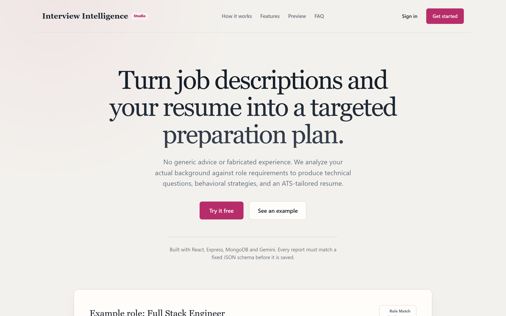

# Interview Intelligence & ATS Resume Studio

> **Live demo:** https://interview-ai-assistance.vercel.app/ (React frontend on Vercel, Express API on Render; the free API can take up to a minute to wake)



| | |
|---|---|
| **What it does** | Turns a resume and a job description into an interview report: likely questions with answers grounded in the candidate's own evidence, skill gaps ranked by severity, and a day-by-day prep roadmap. Also generates ATS-style resume Markdown and exports it to PDF. |
| **Stack** | React 19, Vite 8, Node.js, Express 5, MongoDB (Mongoose 9), Google Gemini (`@google/genai`), Zod, JWT, Puppeteer, Docker |
| **Security** | JWT auth with a token blacklist on logout, rate limiting on auth and API routes, per-user report isolation |
| **Status** | Deployed on Vercel and Render. The backend has 2 smoke tests; there are no end-to-end tests and no formal evaluation of AI output quality yet. |
| **Built with** | AI coding tools (Claude Code, Google Antigravity) |

### How it works
1. The React app sends the job description, a self-description and an optional PDF resume to the Express API.
2. The API extracts the PDF text and calls Gemini with a prompt that restricts answers to the candidate's evidence. The response must match a Zod-derived JSON schema.
3. Reports and resume-tailoring jobs are stored in MongoDB and are only returned to the user who created them.
4. For resume export, a shared headless Chrome (Puppeteer) instance inside the Docker image prints the resume to PDF.

### Known limitations
- No automated check of how good or correct the AI answers are.
- Tests are limited to two backend smoke tests.


Evidence-based AI interview preparation and ATS resume tailoring platform built with React, Node.js, Express, MongoDB, and Google Gemini.

---

## Features

- **Public Landing Page:** Overview of product capabilities, 3-step workflow, features, and FAQ.
- **Role Context Analysis:** Analyzes job description, candidate self-description, and uploaded PDF resume.
- **Evidence-Based Extraction:** Prevents fabricated experience by grounding all questions and answers strictly in candidate inputs.
- **Technical & Behavioral Questions:** Role-specific questions with candidate-grounded answers and interviewer evaluation intent.
- **Skill Gap Prioritization:** Categorizes gaps by severity (critical, high, medium, low).
- **Day-by-Day Roadmap:** Actionable daily milestones with study topics and practice tasks.
- **ATS Resume Studio:** Generates structured Markdown resumes in Classic, Modern, and Compact layouts, featuring live dual-column editing and print-ready PDF export via headless Chromium.

---

## Tech Stack

- **Frontend:** React 19, React Router 8, SCSS, Axios, Vite 8, Oxlint.
- **Backend:** Node.js, Express 5, MongoDB / Mongoose 9, `@google/genai` (Google Gemini), Puppeteer, `pdf-parse`, `express-rate-limit`, Zod, JWT.
- **Containerization:** Dockerfile with Google Chrome for Puppeteer, `docker-compose.yml`.

---

## Getting Started

### Prerequisites

- Node.js (version 20 or higher)
- MongoDB instance (local or MongoDB Atlas)
- Google Gemini API key

### 1. Environment Setup

#### Backend (`Backend/.env`)

```env
PORT=5000
NODE_ENV=development
MONGO_URI=mongodb://127.0.0.1:27017/interview-master
JWT_SECRET=your_minimum_32_characters_secret_key
GOOGLE_GENAI_API_KEY=your_gemini_api_key
FRONTEND_ORIGIN=http://localhost:5173
GOOGLE_GENAI_MODEL=gemini-3.5-flash-lite
```

#### Frontend (`frontend/.env`)

```env
VITE_API_URL=http://localhost:5000
```

### 2. Install Dependencies

```bash
# Backend
cd Backend
npm install

# Frontend
cd ../frontend
npm install
```

### 3. Run Locally

```bash
# In Backend directory
npm run dev

# In frontend directory
npm run dev
```

---

## Verification & Quality Commands

```bash
# Backend smoke tests
cd Backend
npm test

# Frontend linting (0 warnings, 0 errors)
cd frontend
npm run lint

# Frontend production build
cd frontend
npm run build
```

---

## Production Deployment Checklist

1. Configure strong, random `JWT_SECRET` (at least 32 characters).
2. Set `NODE_ENV=production`.
3. Set `FRONTEND_ORIGIN` to your production frontend URL for CORS.
4. Ensure headless Chrome dependencies are installed or use the provided Docker container.
5. Provide verified MongoDB Atlas URI and Google Gemini API key in production environment variables.
